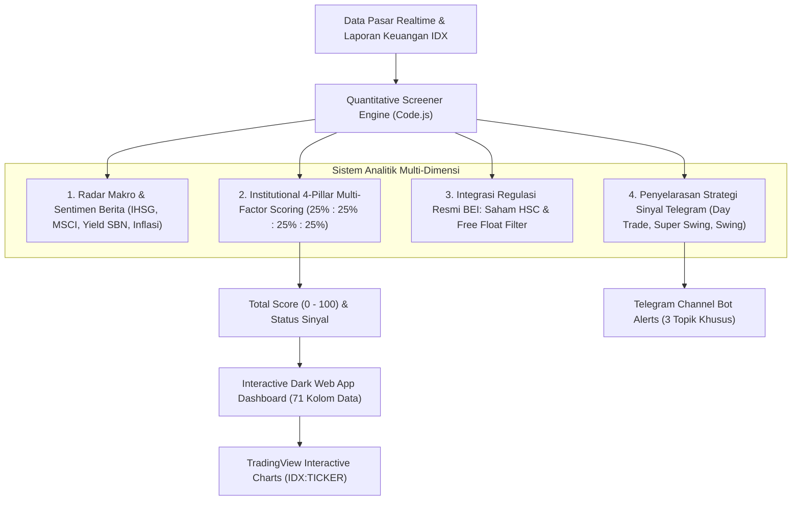

# 📊 OB IDX Screener Dashboard (v2.9.0)

[](https://script.google.com/macros/s/AKfycbwxpoUPugh-U47w0pzYnyfeDRKLPIUlgZmac5jxErGd1xW8o9jV3UX5vE2af8dg6Ri4Rg/exec)
[](https://www.idx.co.id/)
[](https://developers.google.com/apps-script)
[-purple?style=for-the-badge)](https://github.com/)

> **Akses Langsung Web Dashboard:**  
> 👉 [**Buka Web App OB IDX Screener Dashboard**](https://script.google.com/macros/s/AKfycbwxpoUPugh-U47w0pzYnyfeDRKLPIUlgZmac5jxErGd1xW8o9jV3UX5vE2af8dg6Ri4Rg/exec)

---

## ⚠️ PENTING: DISCLAIMER & RISK DISCLOSURE : DYOR

> [!WARNING]
> ### DISCLAIMER / BUKAN REKOMENDASI JUAL / BELI
> 
> 1. **Tujuan Riset & Edukasi**: Seluruh data, grafik, estimasi nilai wajar (*Fair Value*), persentase *upside*, skor kuantitatif (*Total Score*), serta sinyal (*Super Buy, Strong Buy, Buy on Weakness, Early Buy, Hold, Sell, Wait*) yang disajikan pada dashboard ini dihasilkan secara otomatis oleh algoritma kuantitatif matematis dan ditujukan **hanya untuk kepentingan riset, analisis data, dan edukasi pasar modal**.
> 2. **Tidak Menjamin Kevalidan Sinyal**: Sinyal teknikal, proyeksi siklus waktu, dan model valuasi yang ditampilkan **tidak menentukan atau menjamin kevalidan mutlak** dari arah pergerakan harga saham di pasar riil.
> 3. **Bukan Instruksi Transaksi**: Informasi di platform ini **sama sekali BUKAN merupakan rekomendasi, instruksi, ajakan, ataupun bujukan** untuk membeli, menjual, atau menahan instrumen efek/saham manapun di Bursa Efek Indonesia.
> 4. **Do Your Own Research (DYOR)**: Segala keputusan investasi dan transaksi saham yang Anda ambil sepenuhnya merupakan keputusan dan tanggung jawab independen Anda pribadi. Pasar modal memiliki risiko fluktuasi harga yang tinggi hingga risiko kehilangan modal. Pastikan Anda selalu melakukan riset mandiri (*Do Your Own Research*), mempertimbangkan profil risiko, serta mengelola manajemen modal (*money management*) secara bijak.

---

## 🌐 Gambaran Umum Sistem (System Architecture)

**OB IDX Screener (v2.9.0 - Fase 10)** adalah platform analitik dan penyaring saham kuantitatif terintegrasi untuk seluruh emiten di **Bursa Efek Indonesia (IDX/BEI)**. 

Platform ini menggabungkan filosofi multi-perspektif:
- **Passive Fund / Value Investor**: Perlindungan modal (*capital preservation*), disiplin *Margin of Safety* (MoS), dan valuasi fundamental konservatif.
- **Quantitative Pro Trader**: Momentum kinetik (*Volume Ignition*), konfluensi level *Fibonacci*, struktur impulsif *Elliott Wave*, dan asimetri risiko (*Risk-to-Reward Ratio* $\ge 1:2.5$).
- **Global Macro & Cycle Analyst**: Siklus waktu *Astronachi Time Trade*, radar sentimen makro & berita global, serta integrasi regulasi bursa terkini (status resmi **HSC IDX** dan batasan *Free Float*).



---

## 🏛️ Arsitektur Total Scoring 4 Pilar (4-Pillar Balanced Engine)

Total skor dihitung secara berimbang dengan bobot proporsional $25\%$ pada masing-masing pilar utama:

$$\text{TotalScore} = \text{Round}\Big(0.25 \times S_{\text{Val}} + 0.25 \times S_{\text{Flow}} + 0.25 \times S_{\text{TechWave}} + 0.25 \times S_{\text{RiskCycle}}\Big)$$

```
┌────────────────────────────────────────────────────────────────────────┐
│                   TOTAL SCORING ENGINE (100 POIN)                      │
├────────────────────┬────────────────────┬──────────────────────────────┤
│ 1. Valuasi & MoS   │ 2. Flow & Volume   │ 3. Momentum, Wave & Fibo     │
│    (Bobot: 25%)    │    (Bobot: 25%)    │    (Bobot: 25%)              │
├────────────────────┴────────────────────┴──────────────────────────────┤
│ 4. Asymmetric Risk Profile & Astronachi Time Cycle (Bobot: 25%)        │
└────────────────────────────────────────────────────────────────────────┘
```

### 1. Pilar Valuasi Fundamental & Margin of Safety ($S_{\text{Val}}$ - 25%)
- **Model Valuasi Konservatif V1**: Mengintegrasikan *Graham Number*, *Graham Formula dengan Yield SUN 10Y*, *Justified PBV (Gordon Growth)*, dan *5-Year DCF EPS*.
- **BVPS Anchor Rule**: Saham dengan ROE rendah ($< 10\%$) dibatasi secara disiplin tidak boleh melebihi nilai bukunya (`Fair Value` $\le$ `BVPS`).
- **Skor Margin of Safety**: Diskon harga $\ge 30\%$ mendapatkan skor tertinggi (95 poin), didukung pengali kualitas fundamental (`STRONG` bonus, `WEAK` penalti) serta kesehatan rasio utang/buku (DER & PBV).

### 2. Pilar Arus Transaksi & Dinamika Likuiditas ($S_{\text{Flow}}$ - 25%)
- **Smart Money Flow**: Mendeteksi lonjakan volume akumulasi (*Volume Ignition* $\ge 2.0\times$) dan *VSA Accumulation/Absorption*.
- **Peredam Jebakan (Smart Trap)**: Jika terdeteksi indikasi jebakan bandar (`POSSIBLE_BULL_TRAP`), skor pilar flow langsung dipotong ke $\le 20$.
- **Deteksi Distribusi**: Penalti tegas pada fase *Selling Pressure Proxy* atau *No Demand*.

### 3. Pilar Momentum Teknikal, Elliott Wave & Fibonacci ($S_{\text{TechWave}}$ - 25%)
- **Elliott Wave Impulsif**: Bonus prioritas untuk Wave 3 impulsif dan Wave 5 aktif. Penalti keras untuk pembatalan aturan wave (`RULE_VIOLATION` atau `BULLISH_IMPULSE_INVALID`).
- **Konfluensi Fibonacci**: Harga memantul dari area *Golden Ratio* (Retracement 38.2%, 50%, 61.8%) atau *Breakout Resistance*.
- **Trend Alignment & Osilator**: Konvergensi MA20/MA50/MA200, Parabolic SAR multi-timeframe, dan osilator momentum sehat (RSI & MACD).

### 4. Pilar Profil Risiko Asimetris & Siklus Astronachi ($S_{\text{RiskCycle}}$ - 25%)
- **Asymmetric Risk:Reward Ratio**: Menghargai rasio imbal hasil terhadap risiko tinggi ($\text{R:R} \ge 1:2.5$).
- **Volatilitas Terukur (ATR %)**: Memprioritaskan saham dengan volatilitas terkendali dan menolak pergerakan liar tanpa dasar.
- **Konfluensi Siklus Waktu Astronachi**: Mengidentifikasi *Turning Point* pembalikan arah harga (`ASTRONACHI_PEAK_BUY` / `ASTRONACHI_ACCUMULATE`).
- **Penalti Kepatuhan Likuiditas**: Penalti skor untuk saham dengan *Free Float* $< 15.0\%$.

---

## 📡 Penyelarasan Strategi Sinyal Telegram (3 Topik Sinyal)

Sistem pengiriman sinyal otomatis ke Telegram dibagi menjadi 3 topik dengan filter dan filosofi yang terspesialisasi:

### 1. ⚡ Topik DAY_TRADE (Fast Trade / Momentum Pantulan Fibo & Elliott Wave)
- **Fokus Utama**: Menangkap momentum kinetik harian dengan probabilitas tinggi.
- **Kriteria Kunci**:
  - **Pantulan / Breakout Fibonacci**: Memantul dari Support Fibonacci (38.2%, 50%, 61.8%) atau terkonfirmasi *Breakout Resistance*.
  - **Upside Headroom**: Jarak harga menuju level *Resistance* terdekat (Fibo/Resistance 20D) wajib menyisakan ruang **$\ge 3.5\%$**.
  - **Elliott Wave Bullish**: Berada pada struktur gelombang impulsif aktif (*Wave 3, Wave 5, Wave 1*).
  - **Volume Ignition**: Rasio volume terhadap rata-rata 20 hari $\ge 1.8\times$ dan nilai transaksi harian $\ge \text{Rp } 500\text{ Jt}$.
  - **Bebas Risiko Ekstrem**: Bebas *Bull Trap*, bukan saham berstatus HSC IDX, dan penutupan candle kuat ($\ge 65\%$ rentang harian).

### 2. 📈 Topik SWING_SUPER (Super Swing — Passive Fund Buy on Weakness)
- **Fokus Utama**: Akumulasi saham berfundamental unggul saat harga terdiskon di area *support*.
- **Kriteria Kunci**:
  - **Wajib Undervalued / At Fair Value**: 
    $$\text{Price} \le 1.05 \times \text{Fair Value} \quad (\text{atau } \text{Upside} \ge -5.0\%)$$
    Saham overvalued ($> 5\%$ di atas Fair Value) dilarang masuk.
  - **Kualitas Fundamental Terjamin**: Emiten wajib berstatus fundamental `"STRONG"` atau `"FAIR"` (Bukan *weak/junk stock*).
  - **Buy on Weakness di Support**: Menguji area support dinamis MA20 ($\pm 3\%$), Support 20D, atau *Golden Pocket* Fibonacci.
  - **Volume Mengering & Bollinger Squeeze**: Volume saat koreksi mengering ($\le 1.35\times$) dan pita Bollinger Bands dalam fase kompresi (*Squeeze/Tightening*).
  - **Asimetri Risiko**: Rasio $\text{Risk-to-Reward} \ge 1:2.0$ (skor optimal untuk $\ge 1:2.5$).

### 3. 🎯 Topik SWING (Astronachi Time Trade Wave Cycle)
- **Fokus Utama**: Memanfaatkan siklus waktu astronomis-siklikal dan perputaran gelombang pasar.
- **Kriteria Kunci**:
  - **Siklus Waktu Astronachi**: Berada dalam rentang waktu pembalikan arah (*Time Window Active* atau `ASTRONACHI_PEAK_BUY`).
  - **Beli Saat Wave Bearish Selesai di Support (Exhaustion)**: Retracement gelombang korektif bearish (*Wave 2, Wave 4, Koreksi ABC*) mencapai titik jenuh tepat di Support 20D, Support MA50, atau Support Fibonacci.
  - **Target Jual Terdefinisi di Resisten Utama**: Sistem menghitung target exit pada Resistance 20D atau Fibonacci Extension (127.2% / 161.8%) dengan potensi reward $\ge 4.0\%$.
  - **Asimetri Risiko**: Rasio $\text{Risk-to-Reward} \ge 1:1.8$.

---

## 🛡️ Integrasi Regulasi Bursa: Saham HSC & Free Float Filter

Dashboard mengintegrasikan regulasi resmi dari Bursa Efek Indonesia (BEI / IDX):
- **Status Resmi HSC (Kepemilikan Saham Terkonsentrasi Tinggi)**: Terhubung langsung dengan daftar penetapan resmi IDX. Saham HSC diberi penanda khusus `HSC_OFFICIAL`, diklasifikasikan ke `EXTREME_RISK | HSC`, dan secara otomatis dibatalkan (*veto*) dari sinyal beli (`WAIT (HSC)`).
- **Aturan Ambang Batas Free Float 15.0%**: Saham dengan porsi saham publik di bawah batas regulasi ($< 15.0\%$) mendapatkan penyesuaian profil risiko ke *Medium/High* dan sinyal beli ditahan (`WAIT (LOW_FREE_FLOAT)`).
- **Perlindungan Saham Sub-50 & FCA Extreme**: Filter likuiditas ketat untuk saham dengan harga di bawah Rp 50 dan pemblokiran total saham papan pemantauan khusus ekstrem ($\le \text{Rp } 10$).

---

## 🖥️ Fitur Dashboard Web App (71 Kolom Data Lengkap)

1. **Preset Kolom Fleksibel (1-Click Presets)**:
   - `Technical`: MA20/50/200, RSI, MACD, Bollinger Bands, Supertrend, ATR, PSAR Multi-Timeframe.
   - `Flow`: Bandarmology, Volume Ratio, Turnover, VSA Signal, Smart Trap Detector.
   - `Cycle`: Fibonacci Retracement & Extension, Elliott Wave Status, Astronachi Time Window & Turning Date.
   - `Fundamental`: Fair Value, Upside Potential, Kualitas Fundamental, ROE, DER, PBV, EPS, BVPS.
   - `HSC / Ownership`: Status Resmi HSC IDX, Persentase Free Float, Pemegang Saham Pengendali, Jumlah Saham Beredar.
   - `Semua Kolom`: Membuka matriks lengkap seluruh 71 kolom data.
2. **Koneksi Langsung ke TradingView**: Klik ticker saham mana saja untuk membuka grafik interaktif langsung di TradingView (`IDX:TICKER`).
3. **Pencarian Cepat & Filter Sinyal**: Filter berdasarkan kode saham, sektor industri, status likuiditas, atau klasifikasi sinyal.
4. **Desain Gelap & Responsif**: Antarmuka *Dark Theme* modern berbasis Bootstrap 5 yang optimal diakses dari desktop maupun ponsel.

---

## 📖 Cara Membaca Parameter Kunci

| Parameter | Keterangan & Logika |
| :--- | :--- |
| **FINAL_SIGNAL** | `SUPER BUY`, `SUPER BUY (ASTRONACHI)`, `STRONG BUY`, `BUY ON WEAKNESS`, `EARLY BUY`, `HOLD`, `SELL`, `WAIT`. |
| **TOTAL_SCORE** | Skor komposit kuantitatif institusional (0–100) gabungan dari 4 pilar berimbang (Valuasi, Flow, Wave/Teknikal, Risk/Cycle). |
| **FAIR_VALUE** | Estimasi nilai wajar intrinsik saham berbasis model defensif multi-metode V1 (Rupiah). |
| **UPSIDE_POTENTIAL** | Selisih persentase harga pasar saat ini terhadap Fair Value (`+` potensi kenaikan, `-` potensi penurunan). |
| **FUNDA_QUALITY** | Kualitas fundamental emiten (`STRONG`, `FAIR`, `WEAK`) berbasis profitabilitas (ROE), leverage (DER), dan margin laba. |
| **HSC_STATUS** | Status penetapan resmi BEI: `HSC_OFFICIAL` (Konsentrasi Tinggi) atau `NORMAL`. |
| **FREE_FLOAT** | Persentase kepemilikan saham publik non-pengendali (ambang batas regulasi bursa: $\ge 15.0\%$). |
| **ENTRY_ZONE** | Rentang harga beli rekomendasi berdasarkan level support dinamis dan volatilitas ATR. |
| **TARGET_PRICE** | Target harga take-profit teknikal berbasis Fibonacci Extension / Resistance 20-Hari. |
| **CUTLOSS_PRICE** | Level stop loss disiplin berbasis Support 20D dan kelipatan ATR yang disesuaikan siklus pasar. |
| **RISK_REWARD** | Rasio perbandingan potensi keuntungan terhadap risiko kerugian (misal `1 : 2.50`). |
| **REVERSAL_EST_DATE**| Proyeksi tanggal jendela siklus waktu pembalikan arah harga berikutnya berbasis siklus kalender bursa. |

---

## 🔗 Tautan Akses

- **Web App Dashboard:** [https://script.google.com/macros/s/AKfycbwxpoUPugh-U47w0pzYnyfeDRKLPIUlgZmac5jxErGd1xW8o9jV3UX5vE2af8dg6Ri4Rg/exec](https://script.google.com/macros/s/AKfycbwxpoUPugh-U47w0pzYnyfeDRKLPIUlgZmac5jxErGd1xW8o9jV3UX5vE2af8dg6Ri4Rg/exec)

---

*Dashboard ini dibangun dan dikembangkan menggunakan Google Apps Script, HTML5, Bootstrap 5, dan terintegrasi langsung dengan ekosistem data Bursa Efek Indonesia (IDX).*
