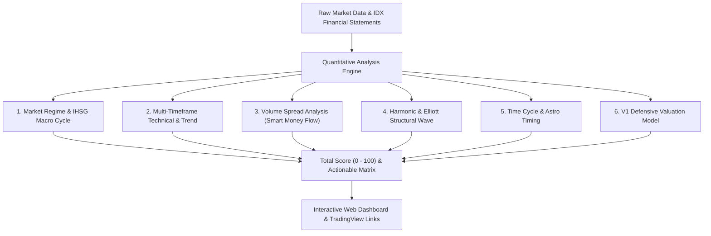

# 📊 OB IDX Screener Dashboard

> **Akses Langsung Web Dashboard:**  
> 👉 [**Klik di sini untuk membuka Dashboard IDX Screener**](https://script.google.com/macros/s/AKfycbwxpoUPugh-U47w0pzYnyfeDRKLPIUlgZmac5jxErGd1xW8o9jV3UX5vE2af8dg6Ri4Rg/exec)

---

## ⚠️ PENTING: DISCLAIMER & RISK DISCLOSURE (DYOR)

> [!WARNING]
> ### DISCLAIMER / BUKAN REKOMENDASI JUAL / BELI
> 
> 1. **Tujuan Informasi & Edukasi**: Seluruh data, grafik, estimasi nilai wajar (*Fair Value*), persentase *upside*, skor (*Total Score*), serta sinyal (*Super Buy, Strong Buy, Buy on Weakness, Hold, Sell*) yang disajikan pada dashboard ini dihasilkan secara otomatis oleh algoritma kuantitatif matematis dan ditujukan **hanya untuk kepentingan riset, analisis data, dan edukasi**.
> 2. **Tidak Menjamin Kevalidan Sinyal**: Sinyal teknikal, proyeksi siklus waktu, dan model valuasi yang ditampilkan **tidak menentukan atau menjamin kevalidan mutlak** dari arah pergerakan harga saham di pasar riil.
> 3. **Bukan Instruksi Transaksi**: Informasi di platform ini **sama sekali BUKAN merupakan rekomendasi, instruksi, ajakan, ataupun bujukan** untuk membeli, menjual, atau menahan instrumen efek/saham manapun di Bursa Efek Indonesia.
> 4. **Do Your Own Research (DYOR)**: Segala keputusan investasi dan transaksi saham yang Anda ambil sepenuhnya merupakan keputusan dan tanggung jawab independen Anda pribadi. Pasar modal memiliki risiko fluktuasi harga yang tinggi hingga risiko kehilangan modal. Pastikan Anda selalu melakukan riset mandiri (*Do Your Own Research*), mempertimbangkan profil risiko, serta mengelola manajemen modal (*money management*) secara bijak.

---

## 🌐 Gambaran Umum (Global Overview)

**IDX Quantitative Screener** adalah platform analitik dan penyaring saham komprehensif untuk emiten di **Bursa Efek Indonesia (IDX/BEI)**. Platform ini menggabungkan berbagai metodologi analisis pasar modal modern ke dalam satu *scoring engine* terpadu secara otomatis.

---

## 🔬 6 Pilar Metodologi Analisis

### 1. Market Regime & Macro Cycle
- **IHSG Context**: Mengukur kondisi makro bursa (Bullish, Neutral, Bearish Regime).
- **Market Breadth**: Rasio saham di atas MA20/MA50 untuk mengukur kekuatan partisipasi pasar secara keseluruhan.

### 2. Multi-Timeframe Technical System
- **Moving Average Alignment**: Konvergensi MA20, MA50, dan MA200.
- **Multi-Period Parabolic SAR**: Memetakan tren simultan pada timeframe Daily, Weekly, hingga Monthly.
- **Supertrend & ATR**: Mengukur tren arah dan volatilitas harian (*Average True Range*).
- **Candlestick Pattern & Confirmation**: Mendeteksi pola *Bullish Engulfing, Hammer, Piercing Line* dengan filter konfirmasi volume.

### 3. Volume Spread Analysis (VSA) & Smart Money Flow
- **Volume Ratio vs MA20**: Mendeteksi lonjakan volume tidak wajar (*abnormal volume spikes*).
- **Bandarmology & Flow Proxy**: Mengidentifikasi fase akumulasi, absorpsi, distribusi, atau *smart trap* sebelum terjadinya *breakout*.
- **Filter Likuiditas**: Menandai emiten dengan status `LIQUID` vs `LOW_LIQUIDITY` berdasarkan *turnover* harian untuk melindungi dari saham tidak likuid.

### 4. Structural Wave & Fibonacci Extension
- **Fibonacci Retracement**: Menghitung area *support/resistance* kunci (rasio 0.382, 0.5, 0.618).
- **Extension Targets**: Menghitung target kenaikan teknikal pada level rasio Fibonacci 1.272 dan 1.618.
- **Elliott Wave Counting**: Mengidentifikasi fase siklus *Impulse Wave* (Gelombang 1-5) atau *Corrective Wave* (A-B-C).

### 5. Time Cycle Timing (Metodologi Astronachi)
- **Time Window Status**: Mengestimasi jendela waktu terjadinya pembalikan arah harga (*Time Cycle Expansion / Peak*).
- **Reversal Estimated Date**: Perkiraan tanggal rotasi arah harga berbasis siklus kalender bursa.
- **Clustered Support**: Pertemuan level *support* teknikal dan siklus waktu.

### 6. Defensive Fundamental Valuation (Model V1)
Model valuasi defensif yang disesuaikan secara khusus dengan karakter emiten Bursa Efek Indonesia (IHSG) untuk mencegah estimasi harga wajar yang melambung tidak wajar:
- **Classic Graham Number**: $\sqrt{22.5 \times \text{EPS} \times \text{BVPS}}$ (menyeimbangkan laba dan ekuitas).
- **Graham Formula dengan Yield Obligasi Negara 10Y**: Menghubungkan laba per saham dengan rasio Surat Utang Negara RI (SUN 10Y) sebesar $6.82\%$ terhadap ekspektasi return pasar ($10\%$).
- **Justified PBV (Gordon Growth)**: Menghubungkan target nilai buku langsung dengan efisiensi modal ($\text{ROE} / 12\%$).
- **5-Year DCF EPS**: Proyeksi arus kas laba 5 tahun dengan tingkat diskonto konservatif.
- **BVPS Anchor Rule**: Saham dengan ROE rendah ($< 10\%$) secara disiplin dinilai di bawah atau maksimal sama dengan nilai bukunya (`Fair Value` $\le$ `BVPS`).

---

## 🖥️ Fitur Dashboard Web App

1. **Preset Kolom Fleksibel**:
   - `Technical`: Fokus pada MA, RSI, MACD, Supertrend, ATR, dan Pola Candle.
   - `Flow`: Fokus pada Bandarmology, Volume Ratio, VSA Signal, dan Smart Trap.
   - `Cycle`: Fokus pada Fibonacci, Elliott Wave, dan Astronachi Time Window.
   - `Fundamental`: Fokus pada Fair Value, Upside Potential, Kualitas Fundamental, dan Sektor.
   - `Semua Kolom`: Membuka matriks lengkap seluruh parameter data.
2. **Koneksi Langsung ke TradingView**: Klik ticker emiten untuk langsung membuka grafik interaktif di TradingView (`IDX:TICKER`).
3. **Penyaringan & Pencarian Cepat**: Filter berdasarkan kode ticker, nama sektor, atau kategori sinyal.
4. **Desain Gelap & Responsif**: Tampilan *Dark Theme* profesional yang nyaman digunakan di perangkat desktop maupun seluler.

---

## 📖 Cara Membaca Parameter Kunci

| Parameter | Keterangan |
| :--- | :--- |
| **FINAL_SIGNAL** | Klasifikasi sinyal: `SUPER BUY`, `STRONG BUY`, `EARLY BUY`, `BUY ON WEAKNESS`, `HOLD`. |
| **TOTAL_SCORE** | Skor komposit kuantitatif (0–100) gabungan dari teknikal, flow, valuasi, dan siklus. |
| **FAIR_VALUE** | Estimasi nilai wajar intrinsik saham berbasis model defensif multi-metode (Rupiah). |
| **UPSIDE_POTENTIAL** | Selisih persentase antara harga pasar terkini dengan nilai wajar (`+` potensi kenaikan, `-` potensi penurunan). |
| **FUNDA_QUALITY** | Kualitas fundamental emiten (`STRONG`, `GOOD`, `FAIR`, `WEAK`) berbasis profitabilitas dan solvabilitas. |
| **LIQUIDITY_STATUS** | `LIQUID` (aman untuk eksekusi standar) atau `LOW_LIQ` (waspada likuiditas tipis). |
| **REVERSAL_EST_DATE** | Estimasi tanggal proyeksi jendela siklus waktu pembalikan arah harga berikutnya. |

---

## 🔗 Tautan Akses

- **Web App Dashboard:** [https://script.google.com/macros/s/AKfycbwxpoUPugh-U47w0pzYnyfeDRKLPIUlgZmac5jxErGd1xW8o9jV3UX5vE2af8dg6Ri4Rg/exec](https://script.google.com/macros/s/AKfycbwxpoUPugh-U47w0pzYnyfeDRKLPIUlgZmac5jxErGd1xW8o9jV3UX5vE2af8dg6Ri4Rg/exec)

---

*Dashboard ini dibangun dan dikembangkan menggunakan Google Apps Script, Python, HTML5, dan Bootstrap 5.*
